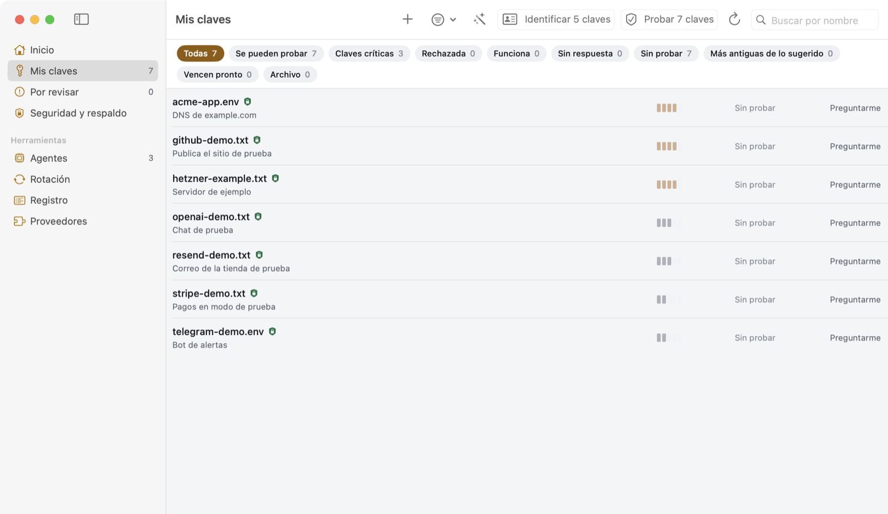
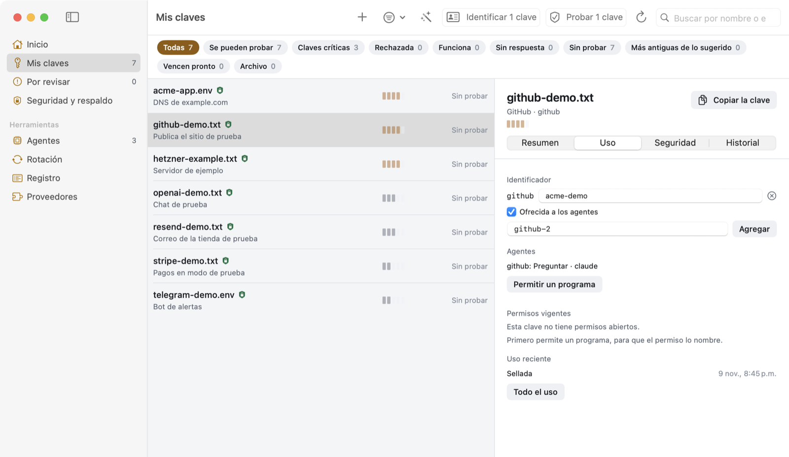
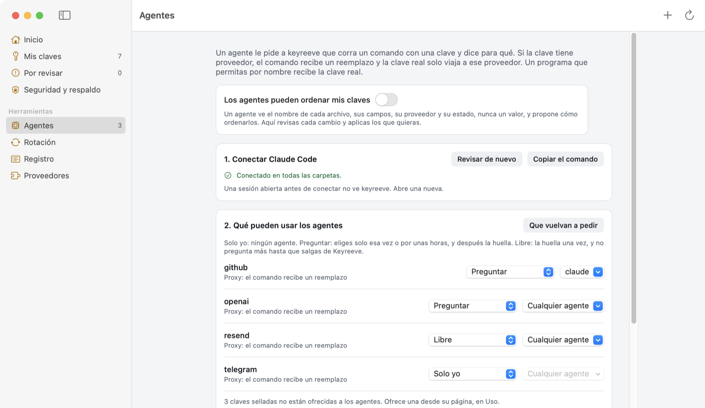

# keyreeve

[](LICENSE)

Una bóveda de claves para tu Mac. Tus claves de API quedan selladas en tu equipo, los agentes las usan sin verlas y lo
propio de cada proveedor vive en una receta chica que escribe la comunidad.

[Sitio](https://carlostapiacl.github.io/keyreeve/es/) · [English](README.md) · [Referencia](docs/reference.es.md) ·
[Modelo de amenazas](THREAT_MODEL.md) · [Seguridad](SECURITY.md) · [Cómo contribuir](CONTRIBUTING.es.md)



**Estado: temprano.** La bóveda, las herramientas para agentes y las pruebas se usan a diario en un Mac. El motor de rotación
pasa el simulador, pero todavía no ha corrido contra un proveedor real. No hay descargas listas.

## Qué hace

- **Sella claves.** Cada clave queda sellada para una llave del Secure Enclave de tu Mac y para una clave de recuperación que
  guardas en otro lado. Los archivos sellados son archivos [age](https://age-encryption.org) estándar, así que puedes
  abrirlos sin keyreeve.
- **Las prueba.** Una sola consulta de lectura por clave te dice si sigue funcionando y de quién es.
- **Deja que los agentes las usen.** Un agente corre un comando con un reemplazo de la misma forma. Un proxy local pone la
  clave real solo en las consultas que van al proveedor de esa clave. El agente ve la salida y nunca la clave.
- **Las rota.** Una receta dice cómo crear y revocar una clave en un proveedor. Es la parte menos probada.

## Instalar

Necesitas macOS 14 o más nuevo, las Command Line Tools y [Rust](https://rustup.rs).

```bash
git clone https://github.com/carlostapiacl/keyreeve
cd keyreeve
app/build-app.sh
ditto app/dist/Keyreeve.app /Applications/Keyreeve.app   # una vez
open /Applications/Keyreeve.app
```

Después de esa primera copia, cada vez que corres `build-app.sh` se actualiza la copia de Aplicaciones. Si Keyreeve estaba
abierto, lo cierra antes y lo vuelve a abrir al final. La compilación no está notarizada, así que macOS te avisa la primera vez.

El comando `keyreeve` solo, sin la app, también corre en Linux: `cargo install --git https://github.com/carlostapiacl/keyreeve`.

## Los primeros cinco minutos

1. **Abre la app** y aprieta **Trae tus claves**. Busca donde las herramientas guardan claves en este Mac (y en las carpetas
   de proyectos que marques, para los `.env`) o en una carpeta que elijas, prueba cada clave y te muestra lo que encontró con
   los valores tapados. Tú decides solo las dudosas y sellas con tu huella una vez. Tus archivos quedan donde están.
2. **Crea la bóveda.** En **Seguridad y respaldo**, aprieta **Crear mi bóveda**. Anota la clave de recuperación que muestra
   una sola vez, lejos de este Mac.
3. **Sella una clave.** Copia una clave desde tu proveedor y aprieta **+** (Agregar clave). keyreeve reconoce el
   proveedor por el inicio de la clave y la sella sin dejar un archivo en disco. Las claves que ya están en tu carpeta se
   sellan desde **Seguridad y respaldo** con **Sellar**.
4. **Elige qué ven los agentes.** Una clave que agregas con **+** queda ofrecida a los agentes con el nivel *Solo yo*: ven
   su nombre y pueden pedirla. Una clave de tu carpeta no está ofrecida hasta que abres su página, vas a **Uso** y marcas
   **Ofrecida a los agentes**, o le das un nivel. Después elige un nivel, por ejemplo *Preguntar*.
5. **Conecta tu agente.** **Agentes** copia el comando que conecta Claude Code:
   `claude mcp add --scope user keyreeve -- "<ruta>/keyreeve-vault" mcp`. Otros clientes MCP corren `keyreeve-vault mcp`.

Ahora pídele al agente que use la clave. Llama a `use_key` con un comando como `curl`, tú lo apruebas con tu huella y el
comando corre con el reemplazo. Desde una terminal funciona igual:

```bash
keyreeve-vault use github --reason "listar repos" -- gh repo list
```



## Ofrecida o no

Los agentes solo ven las claves que tú les ofreces. Una clave no ofrecida no aparece en `list_keys`, no se puede pedir y no se
puede usar, ni por un agente ni con `keyreeve-vault use`. Los identificadores que se dan en bloque, con **Darles identificador**
en **Agentes** o con `keyreeve migrate`, parten sin ofrecer. Si dejas de ofrecer una clave, también se cierra: se van su nivel, sus agentes y sus programas
permitidos.

## Niveles

Cada clave ofrecida tiene un nivel, que eliges en la app.

| nivel | qué pasa |
|---|---|
| Solo yo | El que viene por defecto. Los agentes ven el nombre y pueden pedirla con `request_access`. Nada más. |
| Preguntar | Una ventana muestra la clave, el comando y el motivo del agente. Eliges una vez o 1, 4, 8 o 24 horas, o la niegas, y confirmas con tu huella. |
| Libre | Una huella y después cualquier comando hasta que cierres Keyreeve, un día como máximo. |
| Siempre, sin huella | Una huella para sellar una segunda copia, y desde ahí los agentes la usan por el proxy sin preguntar, aunque reinicies. Déjalo para claves que solo leen. |

La clave real (`keyreeve-vault get`, `--real`, `run_with_key`) pide tu huella cada vez. Cerrar Keyreeve, **Bloquear todo** en
la barra de menú o `keyreeve-vault revoke` terminan todos los permisos.



## Cómo la usan los agentes

Los agentes se conectan por [MCP](https://modelcontextprotocol.io) con `keyreeve-vault mcp`. Ninguna herramienta entrega el
valor de una clave.

| herramienta | qué hace |
|---|---|
| `list_keys` | las claves ofrecidas que este agente puede usar, las que tiene cerradas y los proveedores sin clave guardada |
| `use_key` | corre un comando con el reemplazo, a través del proxy local |
| `request_access` | te pide abrir una clave cerrada, o guardar una para un proveedor |
| `run_with_key` | corre un programa que tú permitiste, fijado por su SHA-256, con la clave real en una variable |
| `rotate_key` | te pide rotar una clave sellada |
| `inventory`, `propose` | leen la carpeta sin valores y proponen cambios, solo mientras tú lo permites |
| `find_keys` | busca claves en toda tu carpeta de inicio, en los lugares típicos o en carpetas, sin valores y sin probar nada con el proveedor |
| `propose_bring` | propone cuáles sellar de las encontradas; tú la revisas en Traer y sellas con una sola huella |

Cada sí, cada no y cada uso queda en `~/.keyreeve/audit.jsonl`, sin valores. Cada línea lleva el hash de la anterior, así
`keyreeve-vault audit --verify` encuentra una edición.

## Recetas

Todo lo de un proveedor vive en un archivo YAML. La app no conoce a ningún proveedor por su nombre. Esta es
[`recipes/github.yaml`](recipes/github.yaml), recortada:

```yaml
provider: github
prefixes: [ghp_, github_pat_]
hosts: [api.github.com]
auth: { header: Authorization, prefix: "Bearer " }
verify: { method: GET, path: /user }
```

Una receta es solo datos y no puede correr código. Habla por HTTPS solo con los servidores que declara, sin redirecciones.
keyreeve trae 33 recetas, y 22 ya pasaron una prueba con una clave real. Las tuyas van en `~/.keyreeve/providers/`.

## Seguridad

keyreeve cuida claves. No es un sandbox: un programa que corre con tu usuario puede hacer lo mismo que tú. El código de la
bóveda no ha tenido revisión externa. [THREAT_MODEL.md](THREAT_MODEL.md) dice de qué protege y de qué no, y
[SECURITY.md](SECURITY.md) dice cómo reportar una vulnerabilidad.

## Más

- [docs/reference.es.md](docs/reference.es.md): la bóveda desde una terminal, `keys.toml` y `keyreeve migrate`, claves SSH,
  archivos env, la barra de menú, las pruebas, los campos de una receta y la rotación.
- [CONTRIBUTING.es.md](CONTRIBUTING.es.md): lo que más sirve es una receta para un proveedor que uses.
- [Código de conducta](CODE_OF_CONDUCT.md)

## Licencia

[MIT](LICENSE)
