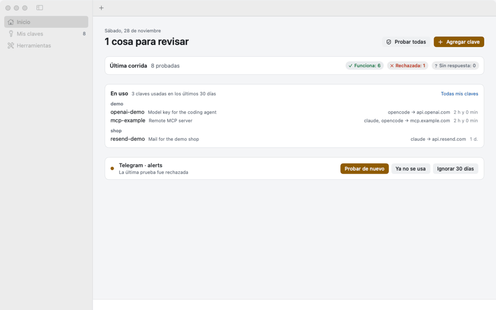
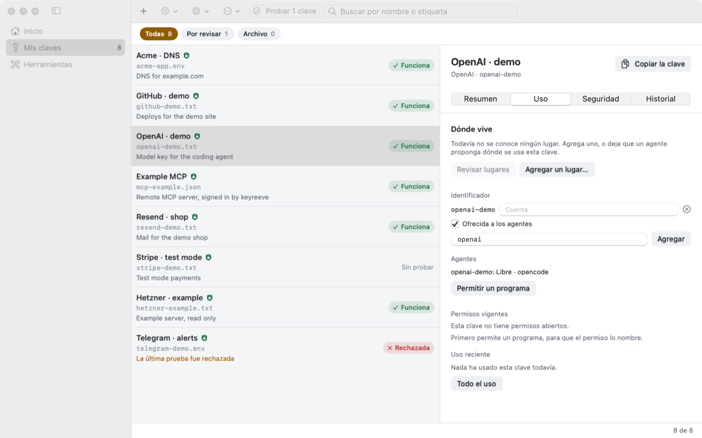
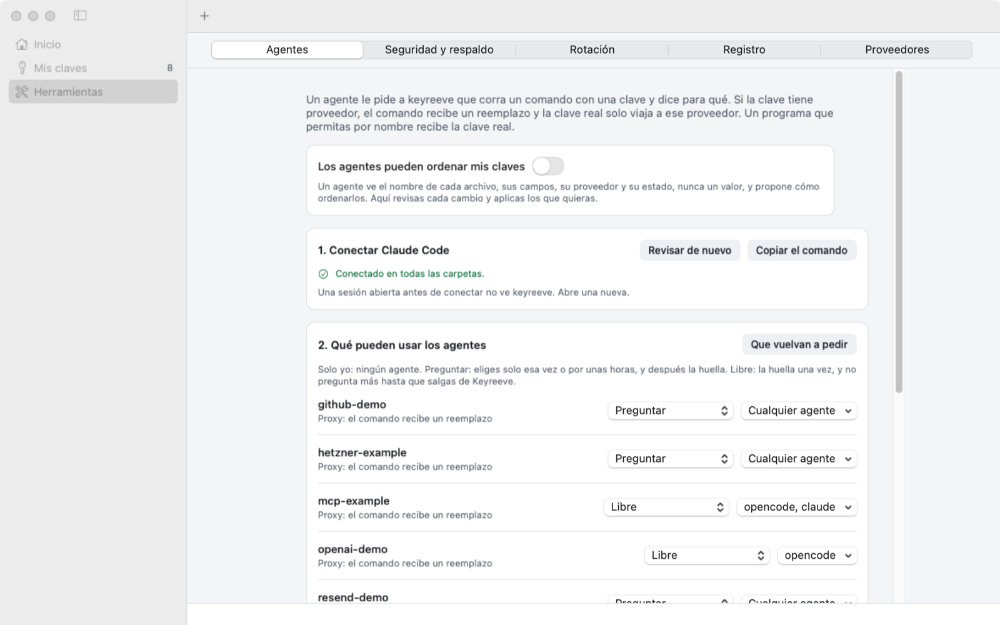

# keyreeve

[](LICENSE)

Una bóveda de claves para tu Mac. Tus claves de API quedan selladas en tu equipo, los agentes las usan sin verlas y lo
propio de cada proveedor vive en una receta chica que escribe la comunidad.

[Sitio](https://carlostapiacl.github.io/keyreeve/es/) · [English](README.md) · [Referencia](docs/reference.es.md) ·
[Modelo de amenazas](THREAT_MODEL.md) · [Seguridad](SECURITY.md) · [Cómo contribuir](CONTRIBUTING.es.md)



**Estado: alpha** ([0.1.0-alpha.2](CHANGELOG.md)). La bóveda, las herramientas para agentes y las pruebas se usan a diario
en un Mac. La rotación es experimental: pasa el simulador, pero todavía no ha corrido contra un proveedor real.

## Qué hace

- **Sella claves.** Cada clave queda sellada para una llave del Secure Enclave de tu Mac y para una clave de recuperación que
  guardas en otro lado. Los archivos sellados son archivos [age](https://age-encryption.org) estándar, así que puedes
  abrirlos sin keyreeve.
- **Las prueba.** Una sola consulta de lectura por clave te dice si sigue funcionando y de quién es.
- **Deja que los agentes las usen.** Un comando corre con un reemplazo de la misma forma. Un proxy local pone la clave real
  solo en las consultas que van al proveedor de esa clave. El agente ve la salida y nunca la clave.
- **Las rota (experimental).** Una receta dice cómo crear y revocar una clave en un proveedor.

## Instalar

En un Mac con macOS 14 o más nuevo (Apple silicon o Intel):

```bash
brew install --cask carlostapiacl/tap/keyreeve
```

Instala Keyreeve.app y el comando `keyreeve`. Keyreeve todavía no está firmado con un Developer ID de Apple, así que la
primera vez macOS dice que no lo puede verificar. Ábrelo una vez desde **Ajustes del Sistema > Privacidad y seguridad >
Abrir igualmente** (en macOS 14 también puedes hacer clic derecho en Keyreeve, en Aplicaciones, y elegir **Abrir**). La
descarga también está en la [página de versiones](https://github.com/carlostapiacl/keyreeve/releases).

En Linux, el comando `keyreeve` solo (pruebas, recetas y el proxy, sin bóveda): `brew install carlostapiacl/tap/keyreeve`.

Para compilarlo tú necesitas las Command Line Tools y [Rust](https://rustup.rs):

```bash
git clone https://github.com/carlostapiacl/keyreeve
cd keyreeve
app/build-app.sh
ditto app/dist/Keyreeve.app /Applications/Keyreeve.app   # una vez
```

## Los primeros cinco minutos

La ventana tiene tres lugares: **Inicio** (lo que espera por ti y las claves en uso), **Mis claves** (la lista) y
**Herramientas** (Agentes, Seguridad y respaldo, Rotación, Registro y Proveedores).

1. **Trae tus claves.** En la primera pantalla, o después en **Herramientas > Seguridad y respaldo** o en
   **Archivo > Traer claves…**. Busca donde las herramientas guardan claves en este Mac, o en una carpeta que elijas, prueba
   cada clave y te muestra lo que encontró con los valores tapados. Tú decides las dudosas y sellas con una huella. Tus
   archivos quedan donde están.
2. **Crea la bóveda.** En **Herramientas > Seguridad y respaldo**, aprieta **Crear mi bóveda**. Anota la clave de
   recuperación que muestra una sola vez, lejos de este Mac.
3. **Agrega una clave.** Cópiala desde tu proveedor y aprieta **+**. keyreeve reconoce el proveedor por el inicio de la clave.
4. **Ofrécela a los agentes.** En la página de la clave, en **Uso**, marca **Ofrecida a los agentes** y elige un nivel.
5. **Conecta tu agente.** **Herramientas > Agentes** copia el comando para Claude Code:
   `claude mcp add --scope user keyreeve -- "<ruta>/keyreeve-vault" mcp`. Otros clientes MCP corren `keyreeve-vault mcp`.

Después pídele al agente que use la clave. Llama a `use_key` con un comando como `curl`, tú lo apruebas con tu huella y el
comando corre con el reemplazo. Lo mismo desde una terminal:

```bash
keyreeve-vault use github --reason "listar repos" -- gh repo list
keyreeve-vault use meta-ads,calcom,sentry -- python3 reporte.py   # varias claves, una ventana, una huella
```



## Agentes de código y servidores MCP

Un agente de código puede correr entero bajo `use`, así que solo tiene reemplazos: su configuración, su base de datos y sus
registros nunca tienen una clave real.

```bash
keyreeve-vault use openai,github --as openai=OPENAI_API_KEY,github=GITHUB_TOKEN --for 8h -- opencode
```

Su configuración apunta a las variables (`{env:OPENAI_API_KEY}` en opencode), también en los encabezados de un servidor MCP
remoto. Un servidor MCP remoto que pide iniciar sesión con OAuth lo inicia keyreeve una vez, y después guarda el refresh
token y renueva el token de acceso por su cuenta: ver
[la referencia](docs/reference.es.md#un-servidor-mcp-remoto-que-inicia-sesión-con-oauth).

## Niveles

| nivel | qué pasa |
|---|---|
| Solo yo | El que viene por defecto. Los agentes ven el nombre y pueden pedirla con `request_access`. Nada más. |
| Preguntar | Una ventana muestra la clave, el comando y el motivo del agente. La permites una vez o de 1 a 24 horas, con tu huella. |
| Libre | Una huella y después cualquier comando hasta que cierres Keyreeve, un día como máximo. |
| Siempre, sin huella | Los agentes la usan por el proxy sin preguntar, aunque reinicies. Déjalo para claves que solo leen. |

El valor real (`keyreeve-vault get`, `--real`, `run_with_key`) pide tu huella cada vez. Cerrar Keyreeve, **Bloquear todo**
en la barra de menú o `keyreeve-vault revoke` terminan todos los permisos. Cada sí, no y uso queda en
`~/.keyreeve/audit.jsonl`, sin valores y con cada línea encadenada a la anterior.



## Recetas

Todo lo de un proveedor vive en un archivo YAML. La app no conoce a ningún proveedor por su nombre. Esta es
[`recipes/github.yaml`](recipes/github.yaml), recortada:

```yaml
provider: github
prefixes: [ghp_, github_pat_]
hosts: [api.github.com]
auth: { header: Authorization, prefix: "Bearer " }
verify: { method: GET, path: /user }
```

Una receta es solo datos y no puede correr código. Habla por HTTPS solo con los servidores que declara. keyreeve trae 33
recetas; las tuyas van en `~/.keyreeve/providers/`, y tú apruebas cada servidor nuevo.

## Seguridad

keyreeve cuida claves. No es un sandbox: un programa que corre con tu usuario puede hacer lo mismo que tú, y un comando que
un agente corre con un reemplazo puede usar la clave, sin leerla. El código de la bóveda no ha tenido revisión externa.
[THREAT_MODEL.md](THREAT_MODEL.md) dice de qué protege y de qué no, y [SECURITY.md](SECURITY.md) dice cómo reportar una
vulnerabilidad.

## Más

La [referencia](docs/reference.es.md) tiene el resto: [ofrecida o no](docs/reference.es.md#ofrecida-a-los-agentes),
[cómo entran las claves](docs/reference.es.md#cómo-entran-las-claves),
[todas las herramientas MCP](docs/reference.es.md#agentes-por-mcp),
[dónde vive una clave](docs/reference.es.md#dónde-vive-una-clave), [rotación](docs/reference.es.md#rotar-una-clave), los
comandos de terminal y los campos de las recetas. [CONTRIBUTING.es.md](CONTRIBUTING.es.md): lo más útil es una receta para
un proveedor que uses. Una [skill para agentes](skills/keyreeve/SKILL.md) le enseña a un agente a usar bien keyreeve.

## Licencia

[MIT](LICENSE)
