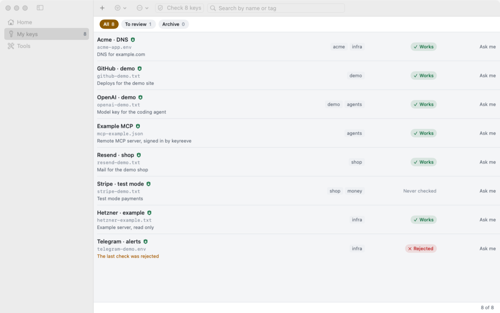
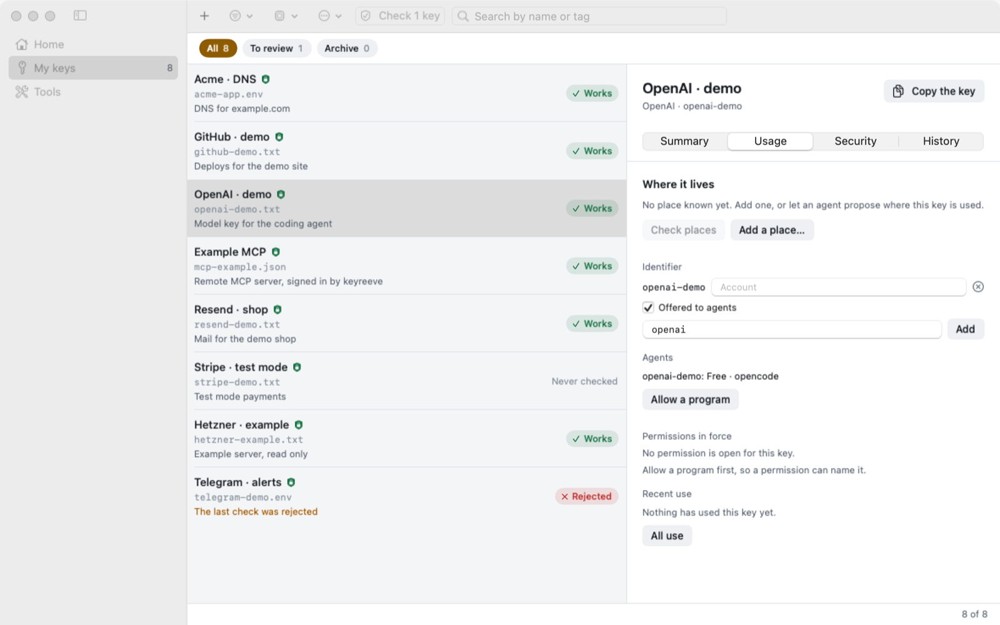
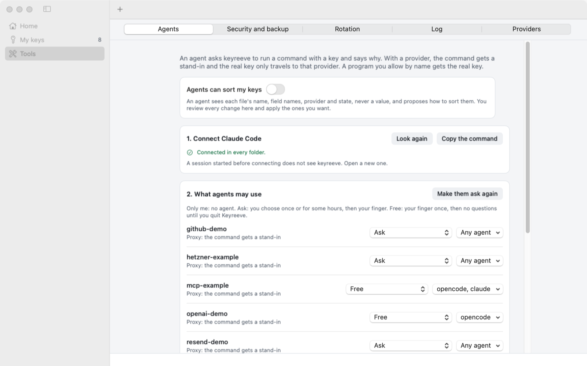

# keyreeve

[](LICENSE)

A key vault for your Mac. Your API keys stay sealed on your machine, agents use them without seeing them, and each
provider's quirks live in a small recipe file the community writes.

[Website](https://carlostapiacl.github.io/keyreeve/) · [Español](README.es.md) · [Reference](docs/reference.md) ·
[Threat model](THREAT_MODEL.md) · [Security](SECURITY.md) · [Contributing](CONTRIBUTING.md)



**Status: early.** The vault, the agent tools and the checks are used every day on one Mac. The rotation engine passes the
simulator but has not run against a real provider yet. There are no prebuilt downloads.

## What it does

- **Seals keys.** Each key is sealed for a key in your Mac's Secure Enclave and for a recovery key you keep elsewhere. The
  sealed files are standard [age](https://age-encryption.org) files, so you can open them without keyreeve.
- **Checks them.** One read-only request per key tells you whether it still works, and whose it is.
- **Lets agents use them.** A command runs with a stand-in of the same shape. A local proxy puts the real key only on
  requests to that key's provider. The agent sees the output and never the key.
- **Rotates them.** A recipe says how to create and revoke a key at a provider. This part is the least tested.

## Install

You need macOS 14 or later, the Command Line Tools and [Rust](https://rustup.rs).

```bash
git clone https://github.com/carlostapiacl/keyreeve
cd keyreeve
app/build-app.sh
ditto app/dist/Keyreeve.app /Applications/Keyreeve.app   # once
open /Applications/Keyreeve.app
```

Each later run of `build-app.sh` updates the copy in /Applications. The build is not notarized, so macOS warns you the
first time. The `keyreeve` command alone runs on Linux too: `cargo install --git https://github.com/carlostapiacl/keyreeve`.

## The first five minutes

The window has three places: **Home** (what waits on you and the keys in use), **My keys** (the list) and **Tools**
(Agents, Security and backup, Rotation, Log and Providers).

1. **Bring in your keys.** On the first screen, or later in **Tools > Security and backup** or **File > Bring in keys…**.
   It looks where tools keep keys on this Mac, or in a folder you choose, checks each key and shows what it found with the
   values hidden. You decide the doubtful ones and seal with one fingerprint. Your files stay where they are.
2. **Create the vault.** In **Tools > Security and backup**, press **Create my vault**. Write down the recovery key it
   shows once, away from this Mac.
3. **Add a key.** Copy it from your provider and press **+**. keyreeve tells the provider from how the key starts.
4. **Offer it to agents.** On the key's page, under **Usage**, check **Offered to agents** and pick a level.
5. **Connect your agent.** **Tools > Agents** copies the command for Claude Code:
   `claude mcp add --scope user keyreeve -- "<path>/keyreeve-vault" mcp`. Other MCP clients run `keyreeve-vault mcp`.

Then ask the agent to use the key. It calls `use_key` with a command such as `curl`, you approve with your fingerprint, and
the command runs with a stand-in. The same from a terminal:

```bash
keyreeve-vault use github --reason "list repos" -- gh repo list
keyreeve-vault use meta-ads,calcom,sentry -- python3 report.py   # several keys, one window, one fingerprint
```



## Coding agents and MCP servers

A coding agent can run under `use` as a whole, so it holds only stand-ins: its config, its database and its logs never
have a real key.

```bash
keyreeve-vault use openai,github --as openai=OPENAI_API_KEY,github=GITHUB_TOKEN --for 8h -- opencode
```

Point its config at the variables (`{env:OPENAI_API_KEY}` in opencode), including the headers of a remote MCP server. A
remote MCP server that signs in with OAuth is signed in once by keyreeve, which then keeps the refresh token and renews
the access token itself: see [the reference](docs/reference.md#a-remote-mcp-server-that-signs-in-with-oauth).

## Levels

| level | what happens |
|---|---|
| Only me | The default. Agents see the name and can ask for it with `request_access`. Nothing else. |
| Ask | A window shows the key, the command and the agent's reason. You allow it once or for 1 to 24 hours, with your fingerprint. |
| Free | One fingerprint, then any command until you quit Keyreeve, for a day at most. |
| Always, no fingerprint | Agents use it through the proxy with no question, across restarts. Keep it for keys that only read. |

The real value (`keyreeve-vault get`, `--real`, `run_with_key`) asks for your fingerprint every time. Quitting Keyreeve,
**Lock everything** in the menu bar or `keyreeve-vault revoke` ends every permission. Every yes, no and use goes in
`~/.keyreeve/audit.jsonl`, with no values and each line chained to the one before.



## Recipes

Everything about a provider lives in one YAML file. The app knows no provider by name. This is
[`recipes/github.yaml`](recipes/github.yaml), trimmed:

```yaml
provider: github
prefixes: [ghp_, github_pat_]
hosts: [api.github.com]
auth: { header: Authorization, prefix: "Bearer " }
verify: { method: GET, path: /user }
```

A recipe is data and cannot run code. It talks HTTPS only to the hosts it lists. keyreeve ships 33 recipes; your own go in
`~/.keyreeve/providers/`, and you approve each new host.

## Security

keyreeve guards keys. It is not a sandbox: a program running as you can do what you can, and a command an agent runs with
a stand-in can use the key, without reading it. The vault's code has had no outside review.
[THREAT_MODEL.md](THREAT_MODEL.md) lists what it protects against and what it does not, and [SECURITY.md](SECURITY.md)
says how to report a vulnerability.

## More

The [reference](docs/reference.md) has the rest: [offered or not](docs/reference.md#offered-to-agents),
[how keys get in](docs/reference.md#how-keys-get-in), [every MCP tool](docs/reference.md#agents-over-mcp),
[where a key lives](docs/reference.md#where-a-key-lives), [rotation](docs/reference.md#rotate-a-key), the terminal
commands and the recipe fields. [CONTRIBUTING.md](CONTRIBUTING.md): the most useful contribution is a recipe for a
provider you use. An [agent skill](skills/keyreeve/SKILL.md) teaches an agent to use keyreeve well.

## License

[MIT](LICENSE)
