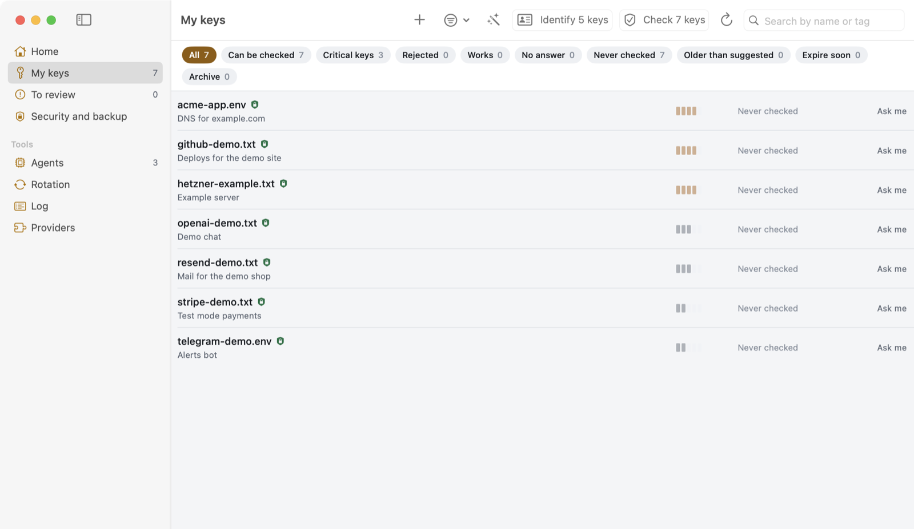
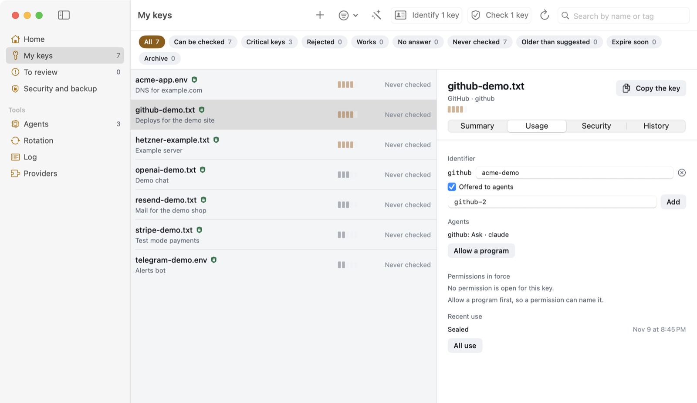
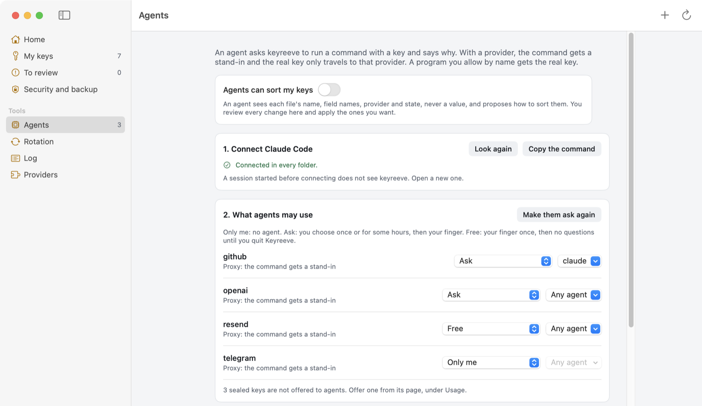

# keyreeve

[](LICENSE)

A key vault for your Mac. Your API keys stay sealed on your machine, agents use them without seeing them, and each
provider's quirks live in a small recipe file the community writes.

[Website](https://carlostapiacl.github.io/keyreeve/) · [Español](README.es.md) · [Reference](docs/reference.md) ·
[Threat model](THREAT_MODEL.md) · [Security](SECURITY.md) · [Contributing](CONTRIBUTING.md)



**Status: early.** The vault, the agent tools and the checks are used every day on one Mac. The rotation engine passes the
simulator but has not run against a real provider yet. There are no prebuilt downloads.

## What it does

- **Seals keys.** Each key is sealed for a key in your Mac's Secure Enclave and for a recovery key you keep elsewhere. The
  sealed files are standard [age](https://age-encryption.org) files, so you can open them without keyreeve.
- **Checks them.** One read-only request per key tells you whether it still works, and whose it is.
- **Lets agents use them.** An agent runs a command with a stand-in of the same shape. A local proxy puts the real key only
  on requests to that key's provider. The agent sees the output and never the key.
- **Rotates them.** A recipe says how to create and revoke a key at a provider. This part is the least tested.

## Install

You need macOS 14 or later, the Command Line Tools and [Rust](https://rustup.rs).

```bash
git clone https://github.com/carlostapiacl/keyreeve
cd keyreeve
app/build-app.sh
ditto app/dist/Keyreeve.app /Applications/Keyreeve.app   # once
open /Applications/Keyreeve.app
```

After that first copy, each run of `build-app.sh` updates the copy in /Applications. If Keyreeve was open, it quits it first
and opens it again at the end. The build is not notarized, so macOS warns you the first time.

The `keyreeve` command alone, without the app, runs on Linux too: `cargo install --git https://github.com/carlostapiacl/keyreeve`.

## The first five minutes

1. **Open the app** and press **Bring in your keys**. It looks where tools keep keys on this Mac (and in the project
   folders you turn on for `.env` files) or in a folder you choose, checks each key, and shows what it found with the values
   hidden. You decide only the doubtful ones, and seal with your fingerprint once. Your files stay where they are.
2. **Create the vault.** In **Security and backup**, press **Create my vault**. Write down the recovery key it shows once,
   away from this Mac.
3. **Seal a key.** Copy a key from your provider and press **+** (Add a key). keyreeve tells the provider from how the key
   starts and seals it with no file on disk. Keys already in your folder are sealed from **Security and backup** with
   **Seal**.
4. **Choose what agents see.** A key you add with **+** is offered to agents at the level *Only me*: they see its name
   and can ask for it. A key from your folder is not offered until you open its page, go to **Usage** and check
   **Offered to agents**, or give it a level. Then pick a level, such as *Ask*.
5. **Connect your agent.** **Agents** copies the command that connects Claude Code:
   `claude mcp add --scope user keyreeve -- "<path>/keyreeve-vault" mcp`. Other MCP clients run `keyreeve-vault mcp`.

Now ask the agent to use the key. It calls `use_key` with a command such as `curl`, you approve it with your fingerprint,
and the command runs with a stand-in. The same works from a terminal:

```bash
keyreeve-vault use github --reason "list repos" -- gh repo list
```



## Offered or not

Agents only see the keys you offer them. A key that is not offered does not appear in `list_keys`, cannot be asked for and
cannot be used, by agents or by `keyreeve-vault use`. Identifiers given in bulk, by **Give them identifiers** in **Agents** or by
`keyreeve migrate`, start not offered.
Taking a key back closes it too: its level, agents and allowed programs go.

## Levels

Each offered key has a level, set in the app.

| level | what happens |
|---|---|
| Only me | The default. Agents see the name and can ask for it with `request_access`. Nothing else. |
| Ask | A window shows the key, the command and the agent's reason. You choose once or 1, 4, 8 or 24 hours, or deny, and confirm with your fingerprint. |
| Free | One fingerprint, then any command until you quit Keyreeve, for a day at most. |
| Always, no fingerprint | One fingerprint to seal a second copy, then agents use it through the proxy with no question, across restarts. Keep it for keys that only read. |

The real key itself (`keyreeve-vault get`, `--real`, `run_with_key`) asks for your fingerprint every time. Quitting
Keyreeve, **Lock everything** in the menu bar or `keyreeve-vault revoke` ends every permission.

An OAuth credential, such as a Google sign-in with a refresh token, takes the same levels. keyreeve keeps the refresh token
and gets the access tokens itself, so an unattended job can read Search Console every Monday and never hold either.



## How agents use it

Agents connect over [MCP](https://modelcontextprotocol.io) with `keyreeve-vault mcp`. No tool returns a key's value.

| tool | what it does |
|---|---|
| `list_keys` | the offered keys this agent may use, the ones closed to it, and providers with no key saved yet |
| `use_key` | runs a command with a stand-in, through the local proxy |
| `request_access` | asks you to open a closed key, or to save one for a provider |
| `run_with_key` | runs a program you allowed, pinned by its SHA-256, with the real key in one variable |
| `rotate_key` | asks you to rotate a sealed key |
| `inventory`, `propose` | read the folder without values and propose changes, only while you allow it |

Every yes, no and use goes in `~/.keyreeve/audit.jsonl`, with no values. Each line carries the hash of the one before, so
`keyreeve-vault audit --verify` finds an edit.

## Recipes

Everything about a provider lives in one YAML file. The app knows no provider by name. This is
[`recipes/github.yaml`](recipes/github.yaml), trimmed:

```yaml
provider: github
prefixes: [ghp_, github_pat_]
hosts: [api.github.com]
auth: { header: Authorization, prefix: "Bearer " }
verify: { method: GET, path: /user }
```

A recipe is data and cannot run code. It talks HTTPS only to the hosts it lists, with redirects off. keyreeve ships 33
recipes, and 22 have passed a check with a real key. Your own go in `~/.keyreeve/providers/`.

## Security

keyreeve guards keys. It is not a sandbox: a program running as you can do what you can. The vault's code has had no outside
review. [THREAT_MODEL.md](THREAT_MODEL.md) lists what it protects against and what it does not, and
[SECURITY.md](SECURITY.md) says how to report a vulnerability.

## More

- [docs/reference.md](docs/reference.md): the vault from a terminal, `keys.toml` and `keyreeve migrate`, SSH keys, env
  files, the menu bar, checks, recipe fields and rotation.
- [CONTRIBUTING.md](CONTRIBUTING.md): the most useful contribution is a recipe for a provider you use.
- [Code of Conduct](CODE_OF_CONDUCT.md)

## License

[MIT](LICENSE)
